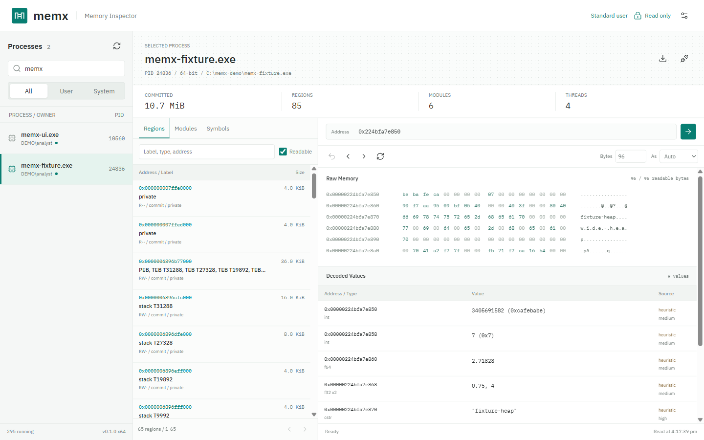
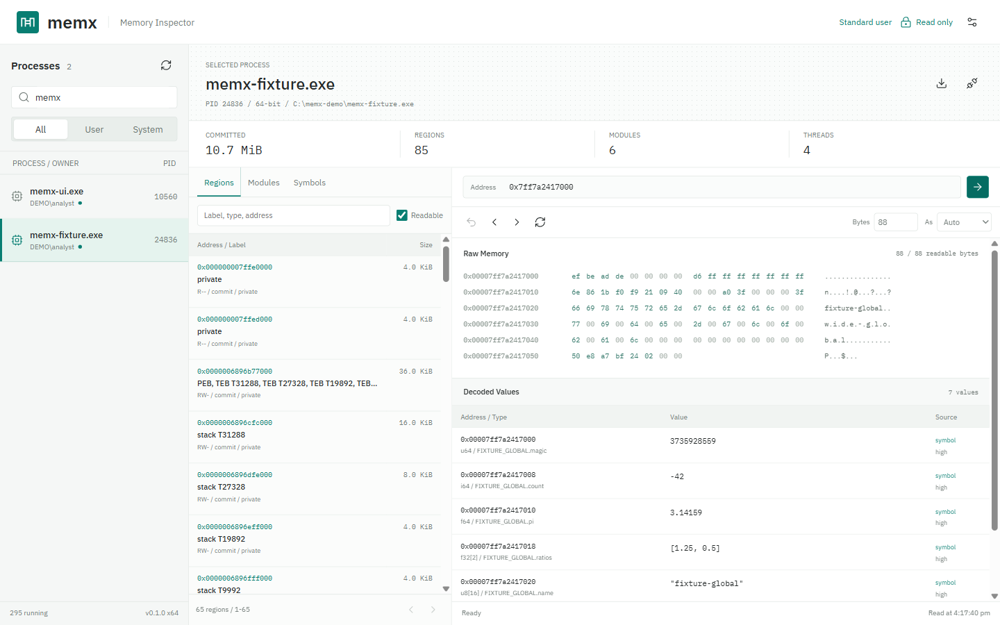
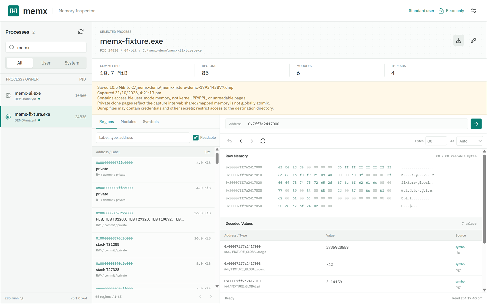
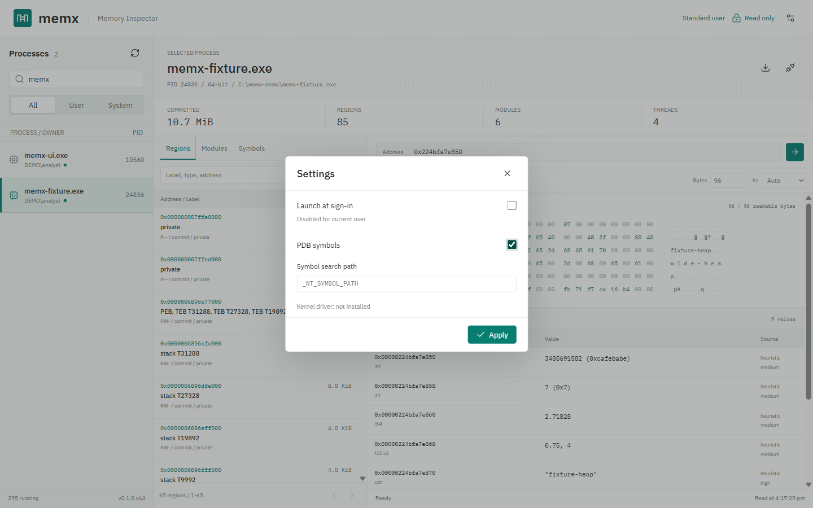
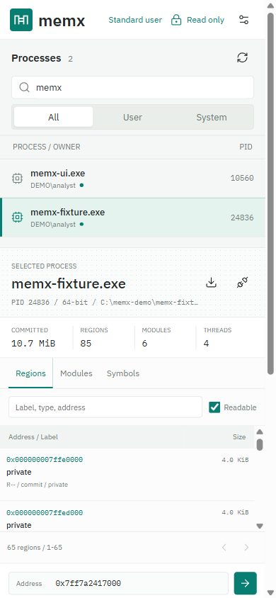

# memx

**Inspect what a running Windows process holds in memory, with a desktop app or the command line.**

memx is a read-only process memory inspector built with Rust and Tauri. It
lists every running process, maps its address space, and decodes bytes into
typed values. Each value shows whether its type came from debug symbols, C++
type information, your choice, or a heuristic guess. It can also capture
point-in-time `.dmp` snapshots for WinDbg.

[Website](https://arteficent.github.io/memx/) ·
[Download](https://github.com/arteficent/memx/releases/latest) ·
[Architecture](docs/ARCHITECTURE.md) ·
[Implementation plan](docs/PLAN.md) ·
[License: MIT OR Apache-2.0](#license)



## Contents

- [Features](#features)
- [Screenshots](#screenshots)
- [Install](#install)
- [Desktop usage](#desktop-usage)
- [Command line](#command-line)
- [Access and safety](#access-and-safety)
- [Build from source](#build-from-source)
- [Debugging](#debugging)
- [Testing](#testing)
- [Versioning and releases](#versioning-and-releases)
- [Project layout](#project-layout)
- [License](#license)

## Features

| | |
|---|---|
| **All processes** | User and system processes, with owner, session, bitness, and an access badge (`readable`, `denied`, `protected`, `x64_required`). |
| **Memory map** | Committed regions labeled as module sections, heaps, thread stacks, PEB/TEB, or mapped files. Modules and PDB globals can be browsed too. |
| **Typed decoding** | `u8`…`u64`, `i8`…`i64`, `f32`, `f64`, `bool`, `ptr`, `cstr`, `wstr`, `guid`, `filetime`, `hex`, plus automatic inference. |
| **Type sources** | Each value is tagged **symbol** (PDB), **rtti** (MSVC C++ type information), **user** (type you selected), or **heuristic** (guess), with a confidence level. |
| **Pointer navigation** | Pointers show their destination, such as a heap, module, or C++ class. Follow them, step back, and page through memory. |
| **Snapshot dumps** | Uses Windows Process Snapshotting to capture memory at a defined moment, then writes a standard full-memory minidump. |
| **One executable** | `memx-ui.exe` opens the GUI when started without arguments and runs CLI or TUI commands when given a command such as `ps`, `read`, or `dump`. |
| **Admin launch** | Release builds request administrator rights through UAC. Optional sign-in startup runs with your account's highest privileges. |
| **x64 and x86** | The x64 build inspects 64-bit and 32-bit (WOW64) processes. The x86 build inspects 32-bit processes. |

## Screenshots

Screenshots use the bundled demo fixture process. User names and paths are
anonymized.

| Browse and decode | Exact types from PDB symbols |
|---|---|
|  |  |
| **Capture a snapshot dump** | **Settings** |
|  |  |

<p align="center"></p>

## Install

Download from [Releases](https://github.com/arteficent/memx/releases/latest):

| File | Use it for |
|---|---|
| `memx-<version>-windows-x64-setup.exe` | Installer for 64-bit Windows. Installs to Program Files and is recommended. |
| `memx-<version>-windows-x64.exe` | Portable 64-bit executable. |
| `memx-<version>-windows-x86-setup.exe` / `-x86.exe` | 32-bit Windows, or inspecting only 32-bit processes. |
| `SHA256SUMS.txt` | Checksums for verifying downloads. |

Requirements: Windows 10 or 11 and Microsoft Edge WebView2. WebView2 is
included in Windows 11; the installer can add it on Windows 10. Binaries are
not code-signed yet, so verify their checksums:

```powershell
Get-FileHash .\memx-0.1.0-windows-x64-setup.exe -Algorithm SHA256
```

## Desktop usage

1. Start **memx** and approve the Windows UAC prompt. Release builds request
   administrator rights so they can read services and other users' processes.
2. Choose a process in the left pane. Filter by name, PID, or owner, or switch
   between **All**, **User**, and **System**.
3. Pick a region, module, or symbol, or enter an address such as `0x7ff6…`,
   `kernel32.dll`, `app.exe+0x1000`, or `app!global_name`.
4. Choose a byte count (1-4096) and a type, or keep **Auto**. Use the arrow
   button on pointer rows to follow them, and back to return.
5. Click the **download** icon next to the process name to save a snapshot `.dmp`.
6. Open **Settings** to enable PDB symbols, set a symbol path such as
   `srv*C:\symbols*https://msdl.microsoft.com/download/symbols`, or enable
   **Launch at sign-in**.

Unreadable bytes appear as `??`. Live reads are not atomic: the target keeps
running, so use **Refresh** to read values again.

## Command line

The same `memx-ui.exe` runs commands when you pass arguments. Run them from an
elevated PowerShell. The executable uses the Windows GUI subsystem, so pipe
output to `Out-Host` or redirect it to a file; PowerShell then waits for the
command and receives its exit code.

```powershell
$memx = 'C:\Program Files\memx\memx-ui.exe'
& $memx --help | Out-Host
```

Every target command accepts `--pid N` or `--name pattern`. Names are
case-insensitive, `.exe` is optional, and `*` and `?` wildcards work.

### Processes and memory layout

```powershell
& $memx ps --filter 'notepad*' | Out-Host
& $memx regions --pid 1234 --readable | Out-Host
& $memx regions --pid 1234 --committed --writable --kind private | Out-Host
& $memx regions --pid 1234 --label heap | Out-Host
& $memx modules --pid 1234 --sections | Out-Host
& $memx threads --pid 1234 | Out-Host
```

### Read and decode

```powershell
& $memx read --pid 1234 --addr 0x1f2a0000 --len 64 | Out-Host           # hex dump
& $memx read --pid 1234 --addr 0x1f2a0000 --as f64 | Out-Host
& $memx read --pid 1234 --addr 'app.exe+0x1000' --as 'u32[4]' | Out-Host
& $memx read --pid 1234 --addr 0x1f2a0000 --len 128 --as wstr | Out-Host
& $memx inspect --pid 1234 --addr 0x1f2a0000 --len 128 | Out-Host       # automatic types
```

Addresses accept hex (`0x…`), decimal, `module`, `module+0xOFFSET`, and
`module!symbol+0xOFFSET`. Arrays use `TYPE[N]`. Pointers use the target
process's pointer size.

### Symbols and search

```powershell
& $memx symbol --pid 1234 'kernel32!CreateFileW' | Out-Host
& $memx globals --pid 1234 --module app.exe --filter '*count*' | Out-Host
& $memx inspect --pid 1234 --addr 'app!g_state' --symbols 'C:\app\pdb' | Out-Host
& $memx search --pid 1234 --string 'hello' | Out-Host
& $memx search --pid 1234 --hex 'de ad ?? ef' --max 20 | Out-Host
& $memx search --pid 1234 --f64 3.14159 --aligned | Out-Host
```

### Snapshot dumps

```powershell
& $memx dump --pid 1234 --file 'D:\dumps\app.dmp' --json | Out-Host
```

The JSON report includes the dump path, size, and capture start, capture end,
and finish times. Existing files are never overwritten. Shared or mapped
memory is not captured atomically, and pages Windows refuses to read are left
out.

### JSON, export, TUI, and startup

```powershell
& $memx regions --pid 1234 --json --out regions.json | Out-Host
& $memx tui --pid 1234                       # keyboard UI: Tab, g goto, t type, f/b follow/back, / search, q quit
& $memx startup status --json | Out-Host
& $memx startup enable --executable $memx | Out-Host    # needs elevation and a Program Files install
& $memx startup disable | Out-Host
```

Global options: `--json`, `--out FILE`, `--symbols PATH`, `--no-symbols`,
`--debug-priv` (requires `SeDebugPrivilege`), and `--suspend` (pauses the
target while reading; not supported for `dump`). See `<command> --help` for
details.

## Access and safety

- **Read-only.** memx never writes to target memory, injects code, or suspends
  a process unless you pass `--suspend`.
- **Administrator rights help, but do not grant access to everything.**
  Protected processes (PP/PPL, such as LSASS with RunAsPPL or antivirus
  services), kernel memory, VBS-protected memory, guard pages, and uncommitted
  pages stay unreadable. memx reports the reason and does not bypass these
  protections.
- **Startup is not a kernel feature.** Sign-in startup is a Task Scheduler
  entry for your account. No service, driver, or boot-time component is
  installed. See [Architecture section 9](docs/ARCHITECTURE.md#9-windows-coverage-kernel-mode-and-startup).
- **Dumps and exports contain secrets.** Save them in a protected folder and
  never commit them. `*.dmp` is in `.gitignore`.

## Build from source

Requirements:

| Tool | Notes |
|---|---|
| Windows 10/11 x64 | Build host |
| [rustup](https://rustup.rs) | Installs Rust 1.99.1 with clippy, rustfmt, and the x64 and x86 MSVC targets from `rust-toolchain.toml` |
| Visual Studio Build Tools | "Desktop development with C++" with a Windows SDK |
| Node.js 22 LTS | Builds the web UI and runs the Tauri CLI |
| WebView2 | Included in Windows 11 |

```powershell
git clone https://github.com/arteficent/memx.git
cd memx
npm ci
npm run build                                   # icons and web assets (required before cargo builds with desktop-ui)
npm run tauri -- build                          # x64 exe + NSIS installer in target\release
npm run tauri -- build --target i686-pc-windows-msvc   # x86 build in target\i686-pc-windows-msvc\release
cargo build --release --bin memx                # optional CLI/TUI-only exe, no WebView
```

Release builds embed a `requireAdministrator` manifest. Debug builds run
without elevation, so tests and development do not trigger UAC.

## Debugging

| Task | Command |
|---|---|
| Desktop app with hot reload | `npm run tauri -- dev` (Vite at `http://127.0.0.1:1420` inside the Tauri window) |
| WebView DevTools | In a debug build, right-click the window and choose **Inspect** |
| Run a CLI command from source | `cargo run --bin memx -- ps --json` |
| Run the unified exe in CLI mode | `cargo run --features desktop-ui --bin memx-ui -- regions --pid 1234` |
| Rust backtraces | `$env:RUST_BACKTRACE = 1` before running |
| Known-value target | `cargo run --bin memx-fixture` prints its PID and field addresses as JSON, then waits for Enter |
| Debug Rust in VS Code | Install CodeLLDB or the C/C++ extension, then launch `target\debug\memx-ui.exe` or `memx.exe` |

`memx-fixture` is the easiest target to start with. Its heap and global
`FixtureData` structs contain `0xDEADBEEF`, `-42`, `3.14159`, and the strings
`fixture-global` and `wide-global`. Its PDB is next to the exe, so you can test
symbol decoding with `memx-fixture!FIXTURE_GLOBAL`.

## Testing

```powershell
npm run build
cargo clippy --all-targets --features desktop-ui -- -D warnings
cargo test --features desktop-ui                                  # x64
cargo test --features desktop-ui --target i686-pc-windows-msvc    # x86

# Read a 32-bit fixture from the x64 build
cargo build --bin memx-fixture --target i686-pc-windows-msvc
$env:MEMX_X86_FIXTURE = (Resolve-Path target\i686-pc-windows-msvc\debug\memx-fixture.exe).Path
cargo test --features desktop-ui --test integration desktop_reads_wow64_fixture_when_provided
Remove-Item Env:MEMX_X86_FIXTURE
```

Integration tests launch `memx-fixture` and check region labels, typed reads,
inference, PDB symbols, search, the desktop request layer, snapshot dumps,
CLI dispatch from the unified exe, and x86 rejection of 64-bit targets.

## Versioning and releases

Versions use [Semantic Versioning](https://semver.org). The source of truth is
`version` in `Cargo.toml`.

- Tauri embeds that version in the exe's FileVersion and ProductVersion and in
  the installer name. `tauri.conf.json` intentionally has no `version` field.
- `npm run version:check` checks that `Cargo.toml`, `Cargo.lock`,
  `package.json`, and `package-lock.json` all have the same version.
- `npm run version:set -- 0.2.0` updates all four files.
- `memx-ui.exe --version` and the desktop footer show the running version.

GitHub Actions:

| Workflow | Trigger | What it does |
|---|---|---|
| [Pull request](.github/workflows/pull-request.yml) | Pull request to `main` | Checks that version files match and the version has not been released. Runs clippy and all tests for x64 and x86, the WOW64 test, and a release compile. |
| [Release](.github/workflows/release.yml) | Merge of a pull request into `main` (or manual run) | Builds x64 and x86 exes and installers, checks the embedded version, and publishes `v<version>` with `SHA256SUMS.txt`. Direct pushes to `main` do not create a release. |

Because every merged pull request creates a release, bump the version in each
pull request.

The website is the static `docs/index.html`. To publish it, open **Settings →
Pages** and choose **Deploy from a branch**: `main`, folder `/docs`.

## Project layout

```text
src/                Rust library, CLI (main.rs) and unified GUI/CLI entry (bin/memx-ui.rs)
  backend/windows/  Win32 process access, PSS dumps, DbgHelp symbols
  desktop.rs        Bounded request API used by the Tauri UI
  startup.rs        Task Scheduler sign-in startup
ui/                 Desktop web UI (Vite, Lucide icons, IBM Plex)
fixture/            Known-value test process
tests/              Integration tests
docs/               Architecture, plan, GitHub Pages site and screenshots
graphify-out/       Knowledge graph of the codebase (graph.html, GRAPH_REPORT.md, graph.json)
scripts/version.mjs Version check/set tool
.github/workflows/  Pull-request and release pipelines
```

The `graphify-out/` folder contains a knowledge graph of the codebase. Open
`graphify-out/graph.html` in a browser, or start with
`graphify-out/GRAPH_REPORT.md`.

## License

Copyright (c) 2026 Sourabh Singh.

memx is free and open source software, licensed under either of

- Apache License, Version 2.0 ([LICENSE-APACHE](LICENSE-APACHE) or <https://www.apache.org/licenses/LICENSE-2.0>)
- MIT license ([LICENSE-MIT](LICENSE-MIT) or <https://opensource.org/licenses/MIT>)

at your option. SPDX identifier: `MIT OR Apache-2.0`.

Unless you explicitly state otherwise, any contribution intentionally
submitted for inclusion in memx by you, as defined in the Apache-2.0 license,
shall be dual licensed as above, without any additional terms or conditions.

Third-party assets keep their own licenses: IBM Plex fonts are under the
[SIL Open Font License 1.1](docs/assets/fonts/OFL.txt), and
[Lucide](https://lucide.dev) icons are under the ISC License. Rust crates and
npm packages are licensed by their respective authors.
