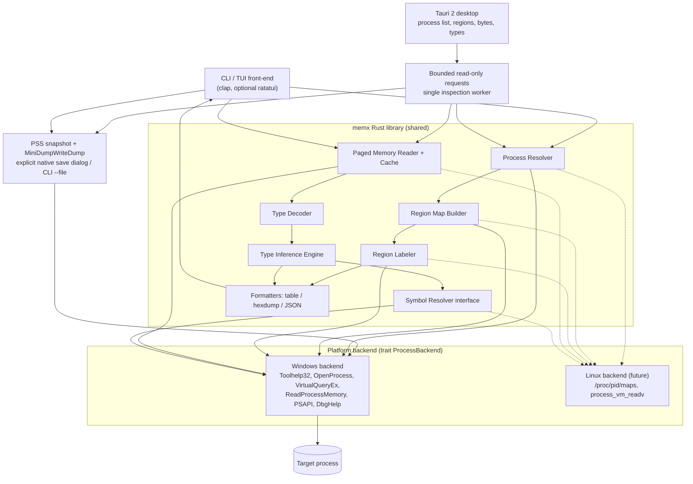
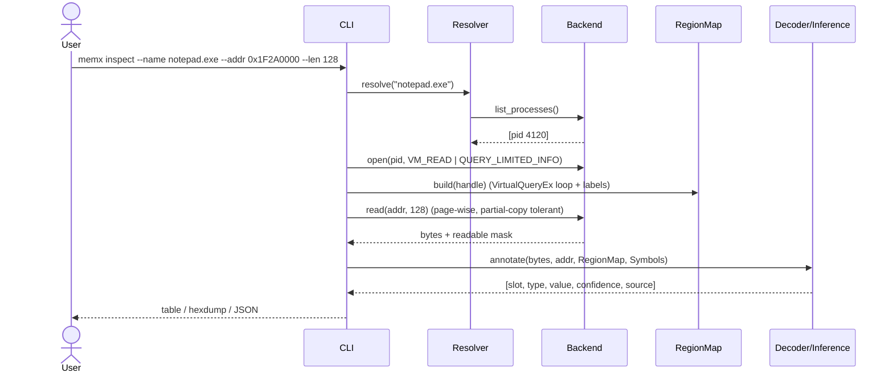
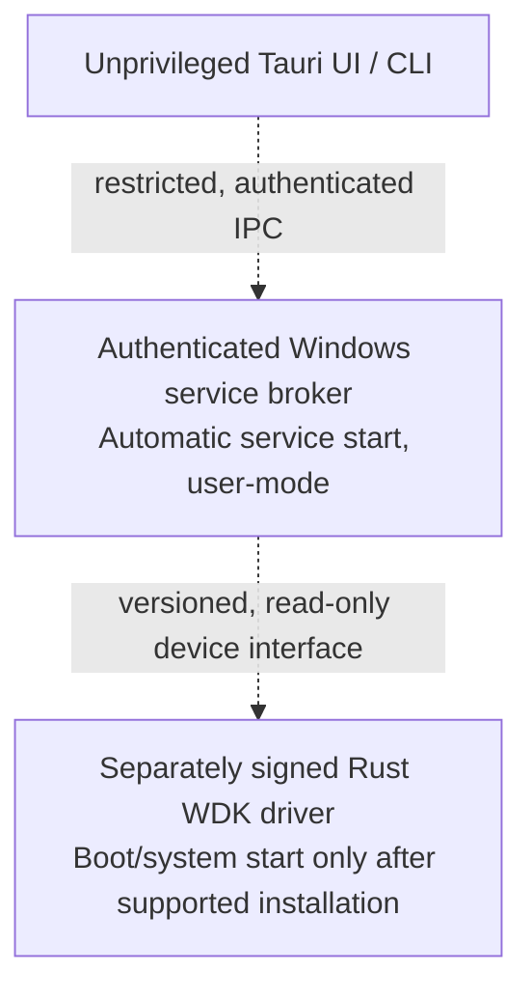

# mem-extract (`memx`) — Architecture

A lightweight, **read-only** process memory inspector. Given a PID or process name, it:

1. Enumerates every virtual memory region of the target process.
2. Labels each region (module image, heap, thread stack, mapped file, private, etc.).
3. Reads the content at any address in a readable region.
4. Decodes the bytes into data types — exactly (via debug symbols) when available, otherwise heuristically with a confidence score.
5. Captures an explicitly requested full-memory user-mode `.dmp` using Windows
    Process Snapshotting (PSS), with capture and completion timestamps.

Primary platform: **Windows x64** (works on 64-bit and 32-bit/WOW64 targets). The design isolates OS calls behind a backend trait so Linux/macOS can be added later.

The application now has a **Rust + Tauri 2 desktop front end**, alongside the CLI
and optional terminal UI. All three reuse the same Rust library and `Session`.
The Windows installer now ships **one application executable: `memx-ui.exe`**.
No arguments open the GUI; command arguments run the existing CLI/TUI in that
same executable. A smaller `memx.exe` CLI-only build remains an optional
developer target, but is not bundled. The GUI embeds its assets; end users do
not need Node.js or Rust. WebView2 remains an OS/runtime prerequisite.

Release builds request **administrator privileges** through the embedded
`requireAdministrator` manifest. Windows presents its normal UAC consent or
credential prompt on manual launch; the application never bypasses it. Debug
builds remain as-invoker so tests do not invoke elevation. Elevated sessions
automatically attempt `SeDebugPrivilege` as before.

One executable is not one OS process: WebView2 uses child processes, and PSS
temporarily creates a VA-clone process. No permanent memory-reader helper or
privileged broker is required for the implemented user-mode workflow.

**Enumerate all processes; inspect only accessible memory.** No implementation
can honestly promise readable memory for every Windows process. PP/PPL,
security policy, guard pages, uncommitted pages, process exits, and kernel
address-space isolation remain real boundaries. Kernel startup is not a Tauri
feature; see section 9 for the separate driver and service architecture.

---

## 1. Key constraints (read before implementing)

| Constraint | Consequence for the design |
|---|---|
| Raw memory has **no type information**. Bytes are just bytes. | Types come from (a) debug symbols (PDB) / RTTI, or (b) heuristics. The UI must always show *how* a type was determined and the confidence. |
| A 64-bit address space is ~128 TB; most is free or reserved. | Enumerate **regions**, not individual addresses. Read content lazily, page by page, only for committed + readable regions. |
| The target keeps running while we read. | Reads are non-atomic. Optional CLI `--suspend` is off by default and is not exposed to the desktop UI. Abrupt termination cannot guarantee resume. |
| Access rights | Only processes the current user can open with `PROCESS_VM_READ`. Admin + `SeDebugPrivilege` widens this. **Protected Processes (PPL, e.g. lsass with RunAsPPL, AV services) are not readable and the tool will not attempt to bypass that** — it reports "access denied" and continues. |
| Bitness | Released as x64 and x86. The x64 build inspects 64-bit and 32-bit (WOW64) targets; the x86 build inspects 32-bit targets and reports `x64_required` / a clear error for 64-bit ones. Pointer width for decoding is taken from the target (`IsWow64Process2`); a 32-bit host reads TEB32/PEB32 layouts directly and rejects addresses it cannot represent instead of truncating them. |
| Memory may contain secrets | No target-memory writes. Data reaches disk only through explicit CLI exports or the native process-dump save action. Existing dump files are never overwritten. |
| Startup and kernel execution are different | Implemented startup is an opt-in current-user Task Scheduler logon task with highest privileges. It is not boot-before-sign-in or kernel execution. |
| Point-in-time process memory has limits | PSS clones private memory at capture time. Shared/mapped memory is not a globally atomic snapshot of every process/device. Missing/inaccessible pages remain omitted. |
| Target architecture must be known | `IsWow64Process2` failure is an error, not a silent assumption of 64-bit pointers. Native ARM64 reader builds are unsupported. |

---

## 2. High-level component view



### Data flow for a typical request



---

## 3. Components

### 3.1 Process Resolver
- Input: `--pid <u32>` or `--name <str>` (case-insensitive, `.exe` optional, glob allowed).
- Windows: `CreateToolhelp32Snapshot(TH32CS_SNAPPROCESS)` + `Process32FirstW/NextW`.
- Multiple name matches → list them and require `--pid` (or `--all` for region listing only).
- CLI output: `ProcessInfo { pid, ppid, name, threads, path, pointer_size }`.
- Desktop catalog adds best-effort `owner`, `session_id`, `category`, and `access`.
    Owner lookup uses the process token SID; system/service classification includes
    built-in service accounts and session 0. Other known sessions are user
    processes; unknown metadata stays unknown. This is not a trust/security label.
- `readable` means a memory-read handle could be opened at enumeration time,
    not that every page is readable. Denied, protected, and unavailable processes
    remain listed and can still be selected to receive a precise access error.

### 3.2 Process Handle / Access
- `OpenProcess(PROCESS_QUERY_INFORMATION | PROCESS_VM_READ, FALSE, pid)`,
  falling back to limited query rights plus memory-read rights.
- If the user runs elevated, automatically try enabling `SeDebugPrivilege` via `AdjustTokenPrivileges`. `--debug-priv` makes failure to enable it fatal; automatic attempts are best-effort so ordinary readable targets still work when privilege assignment is restricted. Neither mode bypasses Windows PP/PPL restrictions.
- RAII wrapper (`OwnedHandle`) closes the handle on drop.
- Failure modes reported cleanly: `AccessDenied`, `ProtectedProcess`, `NotFound`, `Exited`.

### 3.3 Region Map Builder
- Walk the address space with `VirtualQueryEx` from `SYSTEM_INFO.lpMinimumApplicationAddress` to `lpMaximumApplicationAddress`, advancing `BaseAddress + RegionSize`.
- Model:
  ```text
  Region {
      base: u64, size: u64,
      state: Commit | Reserve | Free,
      protect: Flags (R/W/X, Guard, NoCache, WriteCopy),
      kind: Image | Mapped | Private,
      allocation_base: u64,
      label: Option<RegionLabel>,
  }
  ```
- Stored in a sorted `Vec<Region>`; `find(addr)` via binary search (used heavily by the pointer heuristic).
- Filters: `--committed`, `--readable`, `--writable`, `--exec`, `--kind`.

### 3.4 Region Labeler
Attaches a human-readable meaning to regions:

| Label | Source (Windows) |
|---|---|
| Module image + section (`.text`, `.data`, `.rdata`) | `EnumProcessModulesEx(LIST_MODULES_ALL)`, `GetModuleFileNameExW`, PE header parse via `ReadProcessMemory` |
| Mapped file path | `GetMappedFileNameW` |
| Thread stack | `Thread32First/Next` → `NtQueryInformationThread(ThreadBasicInformation)` → TEB → `StackBase/StackLimit` |
| PEB / TEB | `NtQueryInformationProcess(ProcessBasicInformation)` |
| Process heaps | PEB → `ProcessHeaps` array (fast); Toolhelp `Heap32ListFirst` as fallback (slow, optional) |

`ntdll` functions are loaded dynamically; failures degrade to "unlabeled", never abort.

### 3.5 Paged Memory Reader
- `read(addr, len) -> ReadResult { addr, bytes, valid: Vec<bool> }`.
- Splits requests on 4 KiB page boundaries; skips `PAGE_NOACCESS` / `PAGE_GUARD` pages (reading a guard page would alter target behavior).
- Handles `ERROR_PARTIAL_COPY` by retrying per page and marking unreadable bytes.
- Session page cache: 512 pages. Desktop reads clear cached pages for fresh
    values; refresh rebuilds region/module metadata and invalidates symbols too.

### 3.6 Type Decoder (exact, user-chosen)
Given bytes + a requested type, produce a value. Supported types:

`u8 i8 u16 i16 u32 i32 u64 i64 f32 f64 bool ptr cstr (ASCII/UTF-8) wstr (UTF-16LE) guid filetime hex`

Endianness: little-endian (x86/x64). Pointer width from target bitness.

### 3.7 Type Inference Engine (heuristic, `--as auto`)
Walks the buffer in aligned slots (8 bytes for x64 targets, 4 for 32-bit) and emits candidates in priority order:

1. **String** — ≥4 printable ASCII bytes ending in NUL → `cstr`; alternating printable/`0x00` pattern → `wstr`. Spans multiple slots.
2. **Pointer** — value falls inside a committed region in the `RegionMap` → `ptr → <label>` (e.g. `ptr → kernel32.dll!.text`, `ptr → heap`, `ptr → stack(T1234)`). If target points to a string, preview it.
3. **C++ object (MSVC RTTI)** — pointer to a vtable in a module's `.rdata`, and `vtable[-1]` → valid `RTTICompleteObjectLocator` → demangled class name.
4. **Zero / padding** — all bytes zero.
5. **Float/double** — normal (non-denormal, non-NaN) value with magnitude in `[1e-6, 1e9]` and not representable as a small int.
6. **Integer** — high bits zero (small unsigned) or all ones (small negative).
7. **Unknown** — raw hex.

Each annotation carries `confidence: High | Medium | Low` and `source: Symbol | RTTI | Heuristic | User`.

### 3.8 Symbol Resolver (exact types, when available)
- DbgHelp: `SymInitializeW(hProcess, searchPath, FALSE)` + `SymLoadModuleExW` per module.
- `SymFromAddrW` → nearest symbol name + offset.
- `SymGetTypeInfo` (`TI_GET_SYMTAG`, `TI_GET_BASETYPE`, `TI_GET_LENGTH`, `TI_FINDCHILDREN`, `TI_GET_OFFSET`) → real type and struct layout for globals.
- Symbol path: `_NT_SYMBOL_PATH` or `--symbols srv*C:\symbols*https://msdl.microsoft.com/download/symbols`.
- Only works for modules whose PDB is available (OS DLLs via MS symbol server, your own builds). Third-party stripped binaries fall back to heuristics.
- PE export table parsing gives function names even without PDBs.

### 3.9 Formatters
- **Table** — region list (`base | size | state | protect | kind | label`).
- **Hexdump** — classic 16-byte rows, unreadable bytes shown as `??`.
- **Annotated view** — `address | raw hex | type | value | confidence | source`.
- **JSON** — stable schema for scripting / piping.

### 3.10 Front-ends
- **CLI**: one-shot commands, JSON output, explicit file exports, memory search,
    symbols, and startup management. Independent of the desktop feature.
- **TUI**: region list, annotated hex view, goto, types, pointer navigation,
    search, and refresh. Included by the default `tui` feature.
- **Tauri desktop** (`desktop-ui` feature): all-process catalog with name/PID/
    owner filters and All/User/System scope; paged region listing; modules;
    PDB globals; address expressions; raw hex/ASCII and decoded values; pointer
    follow/back/page navigation; refresh; PDB path and sign-in startup settings.
- **IPC boundary**: three commands (`memory_request`, `startup_status`,
    `startup_set`). Memory operations are a strict tagged request enum. There is
    no shell execution, arbitrary filesystem API, target-memory write, injection, or suspend
    operation in the GUI. Remote origins are not granted capabilities.
- **Thread ownership**: a dedicated Rust worker creates and owns the backend,
    process handle, caches, and DbgHelp providers. Requests are serialized on a
    bounded queue (16); the Tauri async runtime does not transfer raw Win32
    handles or block the UI thread. One active session is retained until detach.
- **Limits**: reads 1..4096 bytes, region pages 1..256 items (UI uses 128),
    symbol output first 256 entries, address/filter/path lengths capped.
- **Wire format**: 64-bit addresses are hexadecimal strings, never JavaScript
    Numbers. Unreadable bytes are `null`, rendered `??`. Exact values, RTTI, and
    heuristics carry source/confidence; manual decoding is marked `user/chosen`,
    not falsely presented as recovered type information.

---

## 4. Backend abstraction

```rust
pub trait ProcessBackend {
    fn list_processes(&self) -> Result<Vec<ProcessInfo>>;
    fn list_catalog(&self) -> Result<Vec<ProcessSummary>>;
    fn open(&self, pid: u32, opts: &OpenOptions) -> Result<Box<dyn Process>>;
}

pub trait Process {
    fn info(&self) -> &ProcessInfo;
    fn pointer_size(&self) -> usize;
    fn regions(&self) -> Result<Vec<Region>>;
    fn modules(&self) -> Result<Vec<Module>>;
    fn threads(&self) -> Result<Vec<ThreadInfo>>;
    fn read_raw(&self, addr: u64, buf: &mut [u8]) -> usize;
    fn load_symbols(&self, search_path: Option<&str>, modules: &[Module])
        -> Result<Box<dyn SymbolProvider>>;
    fn dump(&self, path: &std::path::Path) -> Result<DumpReport>;
    // Additional labeling and CLI-only suspend/resume methods are omitted here.
}
```

Linux mapping (future): `/proc` enumeration, `/proc/<pid>/maps` for regions + labels (`[heap]`, `[stack]`, file paths), `process_vm_readv` for reads, DWARF via `gimli` for types. Subject to `ptrace_scope`.

---

## 5. Technology choices

| Concern | Choice | Reason |
|---|---|---|
| Language | **Rust** | Shared inspection core, CLI, and native desktop host |
| Win32 bindings | `windows-sys` + `windows` | Raw read/snapshot bindings and typed Task Scheduler COM interfaces |
| Desktop | `tauri` / `tauri-build` 2 | Optional dependency feature; Windows WebView2; NSIS installer |
| UI assets | Vite, JavaScript, Lucide, local IBM Plex fonts | Embedded build output; no production web server or external font CDN |
| CLI | `clap` (derive) | |
| TUI | `ratatui` | Optional feature flag `tui` |
| Errors | `anyhow` | Contextual Win32 errors; IPC errors are strings |
| Output | `serde` + `serde_json`, local table formatters | CLI/IPC outputs |
| C++ RTTI | Existing `rtti.rs` | Best-effort MSVC class identification, not arbitrary runtime type recovery |

Required Win32 features are declared in Cargo.toml, including Security,
RemoteDesktop (session IDs), ProcessSnapshotting, and TaskScheduler/Ole.

---

## 6. Project layout

```text
mem-extract/
├── Cargo.toml
├── build.rs               # optional Tauri build integration
├── memx.manifest          # release requireAdministrator / Common Controls
├── rust-toolchain.toml    # pinned Rust 1.99.1 + x64/x86 MSVC targets
├── scripts/version.mjs    # version check/set across Cargo and npm files
├── .github/workflows/     # pull-request.yml (build/test), release.yml (x64/x86 release)
├── graphify-out/          # generated knowledge graph of code and docs
├── tauri.conf.json        # window, embedded assets, CSP, installer
├── capabilities/main.json # local window permissions
├── package.json           # UI development/build and icon generation
├── ui/                    # index.html, main.js, style.css, public/mark.svg
├── docs/
│   ├── ARCHITECTURE.md
│   └── PLAN.md
├── src/
│   ├── main.rs              # CLI entry, arg parsing, command dispatch
│   ├── lib.rs               # shared Rust inspection library
│   ├── bin/memx-ui.rs       # unified GUI/CLI entry and IPC commands
│   ├── cli.rs               # clap definitions
│   ├── commands.rs          # CLI command implementations
│   ├── desktop.rs           # serialized session worker and bounded requests
│   ├── startup.rs           # elevated logon task; legacy Run migration
│   ├── session.rs           # session ownership, metadata, lazy symbols
│   ├── model.rs             # ProcessInfo, Region, Module, Annotation ...
│   ├── backend/
│   │   ├── mod.rs           # ProcessBackend / ProcessHandle traits
│   │   └── windows/
│   │       ├── mod.rs
│   │       ├── ffi.rs       # ntdll bindings
│   │       ├── dump.rs      # PSS capture and full-memory minidump output
│   │       └── symbols.rs   # DbgHelp wrapper
│   ├── regionmap.rs         # sorted map + lookup
│   ├── reader.rs            # paging + cache
│   ├── decode.rs            # exact type decoding
│   ├── infer.rs             # heuristic inference + RTTI
│   ├── format.rs            # table, hexdump, annotated, json
│   └── tui.rs               # optional (feature = "tui")
├── fixture/main.rs         # known-value test process
└── tests/integration.rs    # CLI and desktop worker tests
```

---

## 7. CLI surface

```text
memx ps [--filter <glob>]                                  # list processes
memx regions  (--pid N | --name X) [--committed] [--readable] [--kind image|mapped|private] [--json]
memx modules  (--pid N | --name X)
memx read     (--pid N | --name X) --addr 0x... [--len 256] [--as hex|u32|f64|cstr|wstr|ptr|...]
memx inspect  (--pid N | --name X) --addr 0x... [--len 256]     # auto-typed annotated view
memx symbol   (--pid N | --name X) <module!name | 0xaddr>        # resolve symbol <-> address
memx tui      (--pid N | --name X)                              # feature "tui"
memx startup  status [--json]
memx startup  enable --executable <path-to-memx-ui.exe>
memx startup  disable
memx dump     (--pid N | --name X) --file <new.dmp> [--json]

Global: --symbols <path>  --debug-priv  --suspend  --json  --out <file>
```

---

## 8. Error handling & safety

- Every Win32 call wrapped; errors carry the API name + `GetLastError` code.
- A failure in one region/module/thread never aborts the whole listing — it is recorded as a warning.
- No writes to target memory, no code injection, no handle duplication into the target.
- Guard pages are never touched.
- CLI `--suspend` uses `NtSuspendProcess`/`NtResumeProcess` with cleanup on
    ordinary exit and console interruption. A crash or forced termination cannot
    guarantee resume. The desktop never suspends targets.

### Versioning, CI, and releases

- `Cargo.toml` `version` is the single semantic-version source. `tauri.conf.json`
    omits `version`, so Tauri embeds it as the exe FileVersion/ProductVersion and
    installer name. `scripts/version.mjs` keeps `Cargo.lock`, `package.json`,
    and `package-lock.json` in sync (`npm run version:check`, `version:set`).
- The pull-request workflow requires matching versions and an unreleased
    `v<version>` tag, then runs clippy, unit and integration tests for x64 and x86,
    the x64-reads-WOW64 test, and a release compile for both targets.
- The release workflow runs on pushes to `main`, but only builds when the commit
    belongs to a merged pull request (or on manual dispatch). It builds x64 and x86
    exes and NSIS installers, checks the embedded ProductVersion, and publishes
    `v<version>` with SHA-256 checksums. Direct pushes do not release.
- `rust-toolchain.toml` pins the compiler so local builds and CI agree on lints.

## 9. Windows coverage, kernel mode, and startup

| Target / mode | Current behavior |
|---|---|
| Native x64 process | Enumerated; memory readable when Windows grants rights |
| x86 / WOW64 process | Target-specific 4-byte pointers; readable from both the x64 and x86 builds |
| 64-bit process from the x86 build | Listed as `x64_required`; opening it fails with guidance to use the x64 build |
| Ordinary system/service process | Listed with session/owner/access metadata; elevation and SeDebugPrivilege can widen access |
| PP / PPL process | Listed; read denial reported; no bypass |
| PID 0 / System (PID 4) | Listed; not treated as ordinary readable user-process memory |
| Guard, free, reserved, inaccessible pages | Never interpreted as valid bytes |
| Kernel addresses, secure/VBS memory | Not supported |
| Native ARM64 or non-Windows host | Not supported |
| Release administrator launch | Embedded UAC manifest; normal Windows consent/credential flow |
| Start elevated at user sign-in | Implemented, explicit opt-in, current-user highest-privilege scheduled task |
| Process dump at capture time | Implemented, PSS VA clone + full-memory minidump; accessible user-mode pages only |
| Automatic service at Windows boot | Not implemented; requires a separate service host and explicit administrative installation |
| Boot-start kernel driver | Not implemented; requires a separate signed driver and deployment prerequisites |

### Implemented startup

The GUI toggle registers its own installed executable through Task Scheduler
COM APIs, not a frontend-supplied shell command. The task is named
`memx.Inspector.<current-user-SID>`, uses a logon trigger restricted to that SID,
an interactive token, and `TASK_RUNLEVEL_HIGHEST`. No password is stored or
requested by the application. Startup changes require an already-elevated
instance and an executable under the OS-reported Program Files directory.
The per-machine installer uses this location; its ACLs must not be loosened.

Registration updates only the named task and removes the legacy HKCU Run entry
after success. Disable removes the named task and legacy memx entry. Status
reports both. Builds, tests, and ordinary launch never register startup.
Task registration needs one explicit administrative setup action; future sign-in
launches use Windows' registered highest-privilege task without another UAC
prompt. This is not a silent privilege escalation for standard users and is
still subject to domain/task policies. Remove startup before uninstalling;
installer/uninstaller lifecycle cleanup remains future work.

### Point-in-time process dumps

`Process::dump` reopens snapshot-specific read/query/create-process rights and
compares process creation times with the selected handle to reject PID reuse.
It creates a new `.dmp` file and captures a PSS VA clone plus address-space,
thread, and context metadata. `MiniDumpWriteDump` receives the HPSS handle and
an `IsProcessSnapshotCallback` identifying it as a snapshot, not a live target.
The dump uses full-memory/full-memory-info/thread-info flags and omits
inaccessible pages. A process-wide DbgHelp mutex synchronizes symbol and dump
operations, including concurrent library users.

The snapshot is released on every normal/error path, incomplete files are
removed, successful files are flushed, and existing files are never replaced.
`DumpReport` records PID, path, bytes, capture-start/capture-completion and
finish times in Unix milliseconds. There is no silent non-atomic live-dump
fallback if snapshot capture fails. The UI asks for a native save destination;
the CLI requires `--file`, rejecting `--out` and `--suspend` for this command.

Private clone pages reflect capture time, but shared/mapped/device memory and
external resources are not globally atomic. PP/PPL, kernel/secure addresses,
uncommitted and unreadable pages are not magically included. Dumps may contain
credentials or private data; use a restricted directory and do not commit them.
The result is a standard Windows minidump suitable for tools such as WinDbg.

### Separate kernel/boot architecture (future, not shipped)

Tauri is a user-mode WebView host; it must never be moved into kernel mode.
An ordinary Windows service is also **user mode**, not kernel mode. It starts
under SCM in session 0 and cannot directly display this user's interactive UI.
Admin launch and PSS dumping do not require such a service, so none is shipped.
Pre-sign-in boot capture would require a separate service execution mode and
an authenticated cross-session boundary; that is not implemented here.
If a deployment genuinely needs boot-time diagnostics, use separate layers:



The broker would enforce client identity, target authorization, bounded reads,
auditing, and session/process-lifetime checks. A driver would expose a minimal
read-only contract, never arbitrary kernel writes or unrestricted physical
memory mapping. Secure Boot, HVCI, driver-signing policy, and supported WDK/Rust
toolchains must be validated before deployment. No unsigned/test-signing
workaround or PP/PPL bypass belongs in this application.

A signed driver is **not** a promise of access to every process or secure
memory. Signing material, administrative deployment, and a reviewed driver
implementation are external prerequisites; this repository does not silently
install a service/driver or weaken Windows protections.
