# mem-extract (`memx`) — Implementation Plan

See [ARCHITECTURE.md](ARCHITECTURE.md) for the design. This plan delivers it in small, independently testable phases. Each phase ends with a working binary.

## Current Delivery

The Rust CLI/TUI and shared inspection core are implemented. The optional
`desktop-ui` feature now supplies a Tauri 2 application with all-process catalog,
owner/session/access metadata, region/module/symbol browsing, bounded memory
reads, data-type decoding, pointer navigation, and explicit sign-in startup.
The standalone NSIS package includes one executable with GUI and CLI modes. This is
user-mode diagnostics, not unrestricted access to every Windows process.

The original phases below are the implementation history, not a claim that
every proposed optimization or performance target has been verified.

---

## Phase 0 — Project setup

| # | Task | Done when |
|---|---|---|
| 0.1 | `cargo new memx`; add deps: `windows`, `clap`, `anyhow`, `thiserror`, `serde`, `serde_json`, `comfy-table` | `cargo build` passes |
| 0.2 | Pin target to `x86_64-pc-windows-msvc` (`.cargo/config.toml`) | |
| 0.3 | Create `model.rs` (ProcessInfo, Region, Module, ThreadInfo, Annotation) and `backend/mod.rs` traits | Compiles |
| 0.4 | Build the **test fixture** program (`tests/fixture`): allocates known values (u32 `0xDEADBEEF`, f64 `3.14159`, ASCII + UTF-16 strings, a pointer chain, a C++ object with a vtable), prints their addresses as JSON, then waits on stdin | Fixture runs and prints addresses |

---

## Phase 1 — Find and open the process (MVP part 1)

| # | Task | Key APIs |
|---|---|---|
| 1.1 | Enumerate processes | `CreateToolhelp32Snapshot`, `Process32FirstW/NextW` |
| 1.2 | Resolve `--name` → PID(s); handle 0 / 1 / many matches | |
| 1.3 | Open handle with minimal rights; `OwnedHandle` RAII | `OpenProcess`, `CloseHandle` |
| 1.4 | Detect bitness / pointer size | `IsWow64Process2` |
| 1.5 | Automatically attempt debug privilege when elevated; `--debug-priv` requires success; respect PP/PPL | `OpenProcessToken`, `GetTokenInformation(TokenElevation)`, `LookupPrivilegeValueW`, `AdjustTokenPrivileges` |
| 1.6 | `memx ps` command | |

**Exit criteria:** `memx ps --filter note*` lists Notepad; opening a PPL process prints a clear "access denied / protected" message instead of crashing.

---

## Phase 2 — Enumerate memory regions (MVP part 2)

| # | Task | Key APIs |
|---|---|---|
| 2.1 | `VirtualQueryEx` walk from min to max application address | `GetSystemInfo`, `VirtualQueryEx` |
| 2.2 | Map `MEMORY_BASIC_INFORMATION` → `Region` (state, protect flags, kind) | |
| 2.3 | `RegionMap` with binary-search `find(addr)` | |
| 2.4 | Filters (`--committed`, `--readable`, `--kind`) | |
| 2.5 | Table + JSON output; `memx regions` command | |

**Exit criteria:** Region count and totals roughly match Process Hacker / VMMap "Memory" tab for the same process.

---

## Phase 3 — Read memory + hexdump (MVP part 3)

| # | Task | Key APIs |
|---|---|---|
| 3.1 | Page-split reader, skip `PAGE_NOACCESS` / `PAGE_GUARD` | `ReadProcessMemory` |
| 3.2 | Handle `ERROR_PARTIAL_COPY`; per-byte validity mask | |
| 3.3 | Hexdump formatter (`??` for unreadable) | |
| 3.4 | `memx read --addr --len` with `--as hex` | |

**Exit criteria:** Reading the fixture's `0xDEADBEEF` address shows `EF BE AD DE`. Reading across a readable/unreadable boundary shows partial data, no error.

> **MVP = Phases 0–3.** At this point you can list all regions of any accessible process and view raw content at any address.

---

## Phase 4 — Explicit type decoding

| # | Task |
|---|---|
| 4.1 | `decode.rs`: u8…u64, i8…i64, f32, f64, bool, ptr (target width), cstr, wstr, guid, filetime |
| 4.2 | `--as <type>` and `--as <type>[N]` (arrays) on `memx read` |
| 4.3 | Unit tests per type with fixed byte vectors (incl. truncated / invalid UTF-8/16) |

**Exit criteria:** `memx read --addr <fixture f64> --as f64` prints `3.14159`.

---

## Phase 5 — Region labeling

| # | Task | Key APIs |
|---|---|---|
| 5.1 | Modules + paths | `EnumProcessModulesEx(LIST_MODULES_ALL)`, `GetModuleFileNameExW`, `GetModuleInformation` |
| 5.2 | PE header parse (remote) → section ranges `.text/.data/.rdata` | `ReadProcessMemory` |
| 5.3 | Mapped file names | `GetMappedFileNameW` |
| 5.4 | PEB, process heaps | `NtQueryInformationProcess` (dynamic `ntdll` load) |
| 5.5 | Thread stacks via TEB `StackBase/StackLimit` | `Thread32First/Next`, `OpenThread`, `NtQueryInformationThread` |
| 5.6 | WOW64: also read 32-bit PEB/TEB | `ProcessWow64Information` |
| 5.7 | `memx modules`; label column in `memx regions` | |

**Exit criteria:** Every committed region of the fixture has a label or is explicitly `private`; the fixture's stack and heap allocations are labeled correctly.

---

## Phase 6 — Automatic type inference (`memx inspect`)

| # | Task |
|---|---|
| 6.1 | Slot walker (pointer-size aligned) |
| 6.2 | String detectors (ASCII / UTF-16LE), spanning slots |
| 6.3 | Pointer detector using `RegionMap` + label; preview target string if any |
| 6.4 | Float/double plausibility check; integer/zero/padding rules |
| 6.5 | Confidence + source on every annotation |
| 6.6 | Annotated formatter + JSON |
| 6.7 | Tests against the fixture: ≥ 90% of known slots classified correctly |

**Exit criteria:** `memx inspect` on the fixture's struct shows the u32, f64, strings, and pointer chain with correct types.

---

## Phase 7 — Symbols and RTTI (exact types where possible)

| # | Task | Key APIs |
|---|---|---|
| 7.1 | DbgHelp init with symbol path (`--symbols`, `_NT_SYMBOL_PATH`) | `SymSetOptions`, `SymInitializeW`, `SymLoadModuleExW` |
| 7.2 | Address → `module!symbol+offset` | `SymFromAddrW` |
| 7.3 | Global variable types & struct layouts | `SymEnumSymbolsW`, `SymGetTypeInfo` |
| 7.4 | Prefer symbol type over heuristic in `inspect` (source = `Symbol`) | |
| 7.5 | PE export table → function names without PDB | |
| 7.6 | MSVC RTTI: vtable → `RTTICompleteObjectLocator` → class name | `msvc-demangler` |
| 7.7 | `memx symbol` command | |

**Exit criteria:** With the fixture's PDB, `inspect` shows real field names/types of its global struct; the C++ object is identified by class name via RTTI.

---

## Phase 8 — Interactive TUI (optional, feature `tui`)

| # | Task |
|---|---|
| 8.1 | Region list pane with filters |
| 8.2 | Annotated hex pane with LRU page cache |
| 8.3 | Keys: goto (`g`), change type (`t`), follow pointer (`f`), back (`b`), refresh (`r`), search bytes/string (`/`) |

---

## Phase 9 — Hardening & polish

- `--suspend` cleanup on normal exit / Ctrl+C; forced termination cannot guarantee resume.
- Performance: large processes (browsers, IDEs) — region walk < 1 s, streaming JSON output.
- Clear error table (AccessDenied, Protected, Exited, PartialRead).
- Release build profile: `opt-level = "z"`, `lto = true`, `strip = true` for a small binary.
- Optional: Linux backend (`/proc/<pid>/maps`, `process_vm_readv`, DWARF via `gimli`).

---

## Testing strategy

Desktop verification adds schema/length/overflow tests and fixture-driven
catalog, read, unreadable-byte, detach, PDB, and refresh checks. Native Tauri
compilation, frontend asset builds, and NSIS packaging are required gates.
GUI interaction/layout testing complements these core checks.

| Level | What |
|---|---|
| Unit | `decode.rs`, `infer.rs`, `regionmap.rs`, PE parser — pure functions over byte slices, no OS calls |
| Integration | Spawn the fixture, parse its printed addresses, run `memx` commands, assert decoded values |
| Bitness | Build the fixture as both x64 and x86; run the same integration tests (WOW64 path) |
| Negative | Non-existent PID, exited process, PPL process (e.g. `MsMpEng.exe`) → expected error, exit code ≠ 0, no panic |
| Manual comparison | Region list vs. Sysinternals VMMap / Process Hacker |

---

## Milestone summary

```mermaid
gantt
    dateFormat  X
    axisFormat  %s
    section MVP
    P0 Setup            :p0, 0, 1
    P1 Process open     :p1, after p0, 1
    P2 Regions          :p2, after p1, 1
    P3 Read + hexdump   :p3, after p2, 1
    section Types
    P4 Explicit decode  :p4, after p3, 1
    P5 Labels           :p5, after p4, 1
    P6 Inference        :p6, after p5, 1
    P7 Symbols + RTTI   :p7, after p6, 1
    section Extras
    P8 TUI              :p8, after p7, 1
    P9 Hardening        :p9, after p8, 1
```

## Risks

| Risk | Mitigation |
|---|---|
| Heuristic types are wrong | Always show confidence + source; let the user override with `--as` |
| Target memory changes between reads | Document snapshot semantics; offer `--suspend` |
| No PDB for third-party binaries | Fall back to exports, RTTI, heuristics |
| Undocumented `ntdll` structures (PEB/TEB offsets) | Use only stable, widely documented fields; separate 32/64-bit layouts; degrade gracefully |
| AV/EDR flags the tool (it reads other processes' memory) | Read-only, signed release builds, no injection or evasion techniques |

## Remaining Deployment Work

- Code-sign production desktop/CLI binaries and installer using the publisher's
    signing identity. Development artifacts are not publisher-signed.
- Verify x86/WOW64 targets, module churn, exited targets, guarded pages, and
    restricted-token environments across supported Windows versions.
- Add installer-aware cleanup/update of the optional sign-in startup entry.
- Kernel/boot support is a separate project: reviewed Rust WDK driver, signed
    deployment, authenticated service broker, strict authorization/read limits,
    and Secure Boot/HVCI compatibility. Neither a driver nor boot service is
    implemented or installed by this build. PP/PPL bypass is out of scope.

## Administrator And Snapshot Delivery

- The installer now bundles one application executable, with GUI on no arguments
    and CLI/TUI dispatch when command arguments are present.
- Release resources include `requireAdministrator`; normal UAC applies. Debug
    test builds are as-invoker. UI status reports actual token elevation.
- Explicit sign-in registration uses a SID-scoped highest-privilege interactive
    Task Scheduler task and requires elevation plus a Program Files installation.
    No registration or service installation runs during build/test/ordinary launch.
- PSS VA-clone capture writes standard full-memory `.dmp` files via DbgHelp.
    CLI and native-save-dialog UI report timestamps and limits; existing files
    are protected and partial failures cleaned up. DbgHelp calls share a mutex.
- Kernel/boot execution remains separate and unimplemented. A service is not
    kernel mode, and does not make every process/address readable. No PP/PPL,
    Secure Boot, HVCI, or driver-signing bypass is part of the product.
- Privileged registration and actual UAC/boot behavior require manual validation
    from the per-machine installation; automated tests do not request elevation.
